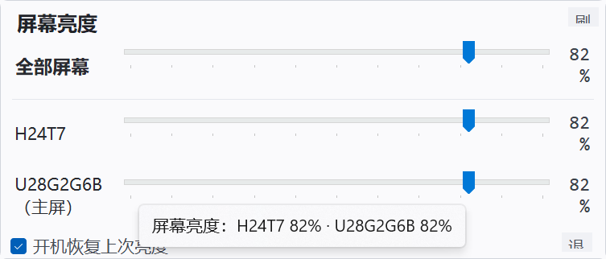

# BrightnessTray · 屏幕亮度托盘

Windows 通知区域多显示器亮度调节工具。通过 DDC/CI 直接控制显示器背光，不是软件滤镜。

- 每块屏幕独立滑块，互不干扰
- 「全部屏幕」总控
- 托盘太阳图标随亮度变化
- 记住每屏亮度，可开机恢复
- 支持热插拔、锁屏解锁、睡眠唤醒

面板：



## 运行

需要 Windows 10/11 x64 和 [.NET 10 桌面运行时](https://dotnet.microsoft.com/download/dotnet/10.0)。

```powershell
git clone https://github.com/passwordand/BrightnessTray.git
cd BrightnessTray
dotnet build src/BrightnessTray.csproj -c Release
.\Start BrightnessTray.cmd
```

托盘图标左键打开面板，右键是预设档位、开机启动和退出。

## 单屏自检

自检会读取原值 → 写入目标值 → 回读确认 → 恢复原值，只修改匹配到的屏幕：

```powershell
$exe = '.\src\bin\Release\net10.0-windows\BrightnessTray.exe'
& $exe --selftest 55 <显示器型号关键词>
& $exe --selftest 55          # 全部屏幕
```

报告写入 `%APPDATA%\BrightnessTray\selftest.txt`。

## 实现说明

部分 NVIDIA + Intel 混合输出环境下，DXVA2 会让两块显示器共享同一条 DDC 通道
（两个 `hPhysicalMonitor` 都是 `0x0`，写 A 屏 B 屏也变），表现为「副屏能调、主屏没反应」。

因此优先使用 `nvapi64.dll` 原生 I2C：

1. `NvAPI_EnumNvidiaDisplayHandle` 枚举显示器
2. `NvAPI_GetAssociatedDisplayOutputId` 取独立 `displayMask`
3. `NvAPI_I2CWrite` / `NvAPI_I2CRead` 按 GPU + `displayMask` 精确读写

没有 NVAPI 时自动回退到 DXVA2。DDC 调用在独立后台线程执行，连续拖动只保留最新目标值。

## 已知限制

- 显示器 OSD 中需开启 DDC/CI
- 锁屏或休眠期间 DDC 通道可能被占用，解锁后会自动重新检测
- 仅实现亮度通道，其它 VCP 可按同样方式扩展

## 项目结构

```
src/
├─ Program.cs                入口、单实例、自检
├─ TrayApplicationContext.cs 托盘图标、菜单、热插拔监听
├─ Core/
│  ├─ DdcEngine.cs           DDC 引擎（后台线程 + 写入合并）
│  ├─ NvApiDdc.cs            NVIDIA 原生 I2C 通道
│  ├─ MonitorInfo.cs         显示器快照
│  ├─ EdidReader.cs          EDID 型号名解析
│  └─ AppSettings.cs         配置持久化
├─ Interop/NativeMethods.cs  Win32 / DXVA2 声明
└─ UI/                       面板与托盘图标
```

## 许可证

[MIT](LICENSE)
